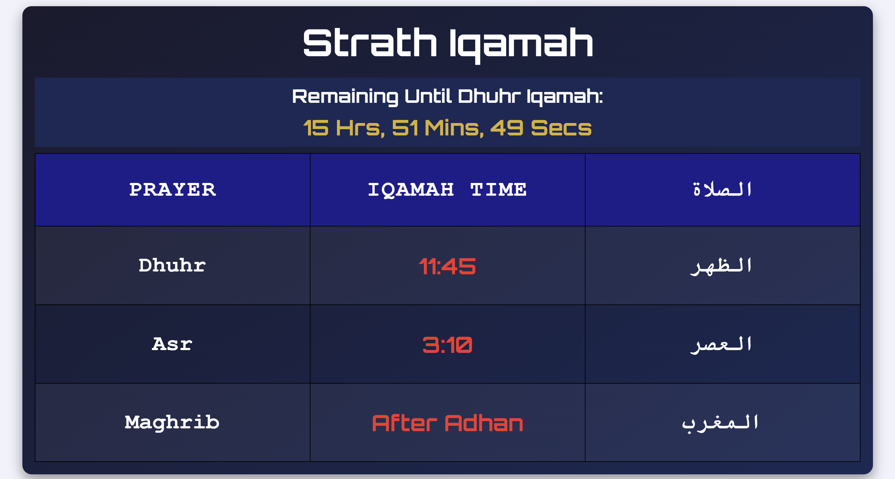
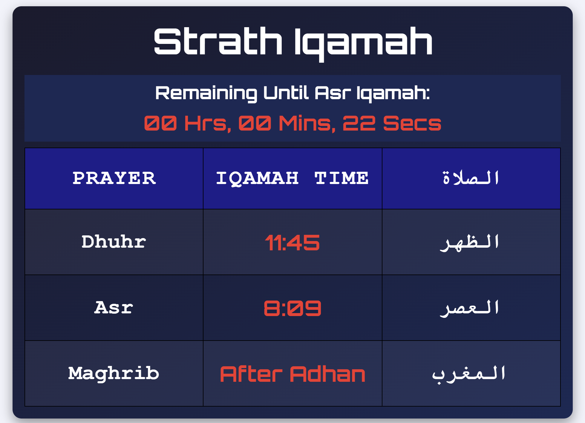
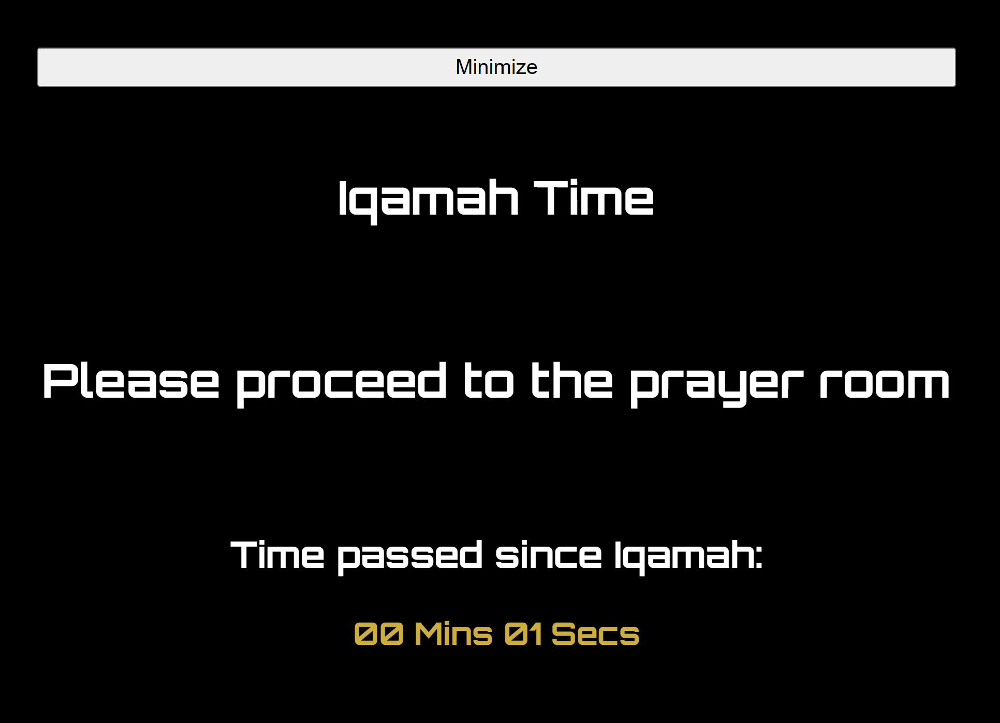
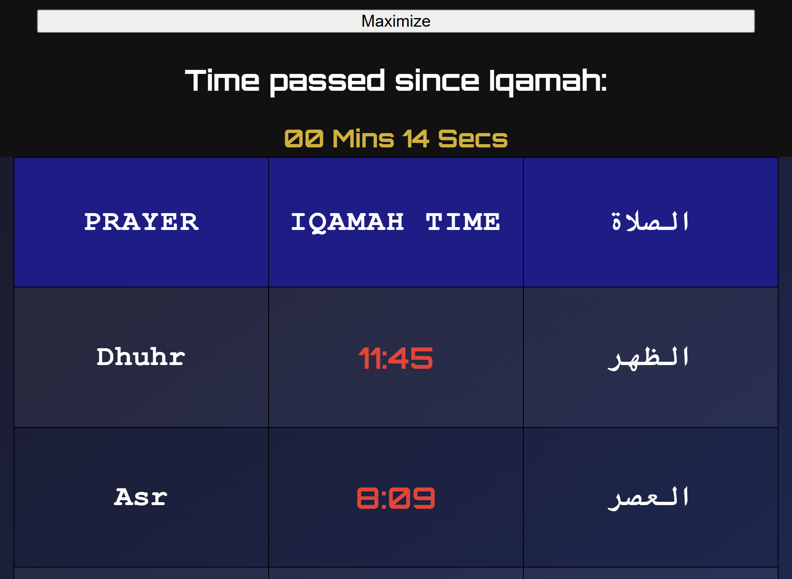
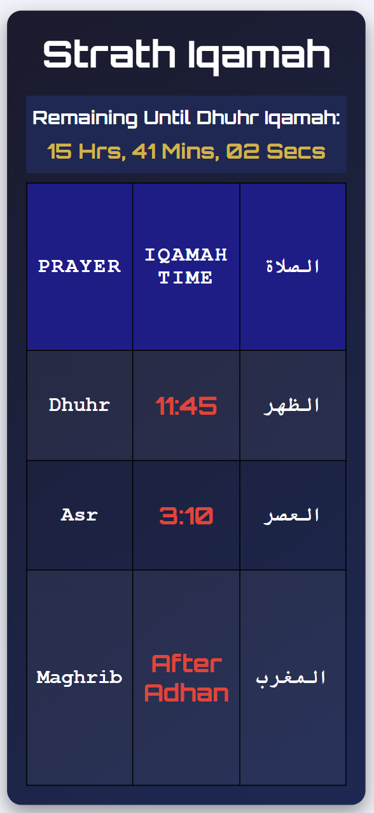
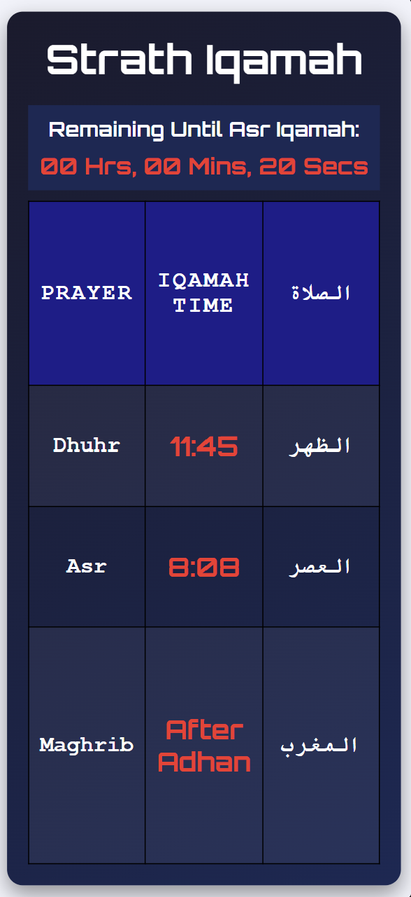
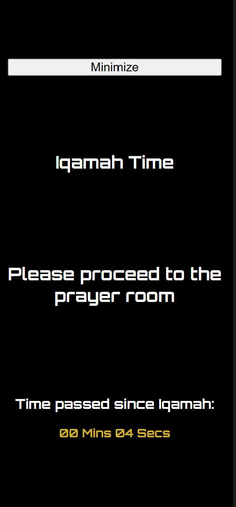
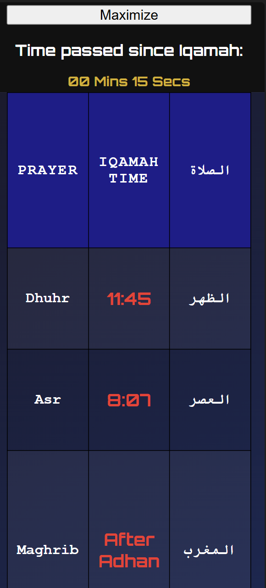

# Strath Iqamah
A simple webpage that aids students and staff members with tracking Prayer Iqamah times and reach the Prayer room on time. 

This webpage focuses **only on Iqamah times** and does not include Adhan times.

 

**Difference between Adhan and Iqamah:**

| Term   | Description |
|--------|-------------|
| **Adhan**  | A call that signals the beginning of the time-period for the Prayer.|
| **Iqamah** | A shorter call to signal that the congregation Prayer is about to begin.|

 

## The typical user of Strathiqamah

| User   | Justification |
|--------|-------------|
| **Muslim**  | This webpage is specifically relevant to the Muslim Prayer **(Salah)**.|
| **StrathclydeBahrain-bound** | Our users include all people who use the Strathclyde Bahrain campus including students and staff members.|
| **Male** | Our campus contains only a male player room **(found in the ground floor)**, and the Iqamah times are only relevant to that room.|

 

## Key Functionalities
- **Live Iqamah Countdown:**

A semi-golden-colored countdown **(rgba(255, 204, 0, 0.849))** is displayed in the top section to inform users of the remaining time until the next Prayer's Iqamah.

The time is presented in Hours, Minutes, and Seconds.

Given our university's operating times, the countdown only accounts for Dhuhr and Asr Iqamah times, while Maghrib is set by default to "Directly After Adhan".

- **Less than 10 Minutes for Iqamah:**

The countdown's color changes to red **(#ff2a2a)**, indicating that users should start preparing to proceed to the prayer room.

- **Once Iqamah Time Happens:**

A black screen fills the screen and covers the Iqamah timetable.

The screen contains messages indicating that Iqamah has happened and that users should proceed to the Prayer room to reach on time and avoid missing the Congregation.

Users can also minimize and maximize this screen to view other Iqamah times if necessary.

 

## Some Prototypes (Some times are inaccurate for testing reasons)
### Large Screens:

 

### Small Screens (Mobile Phone Display):

